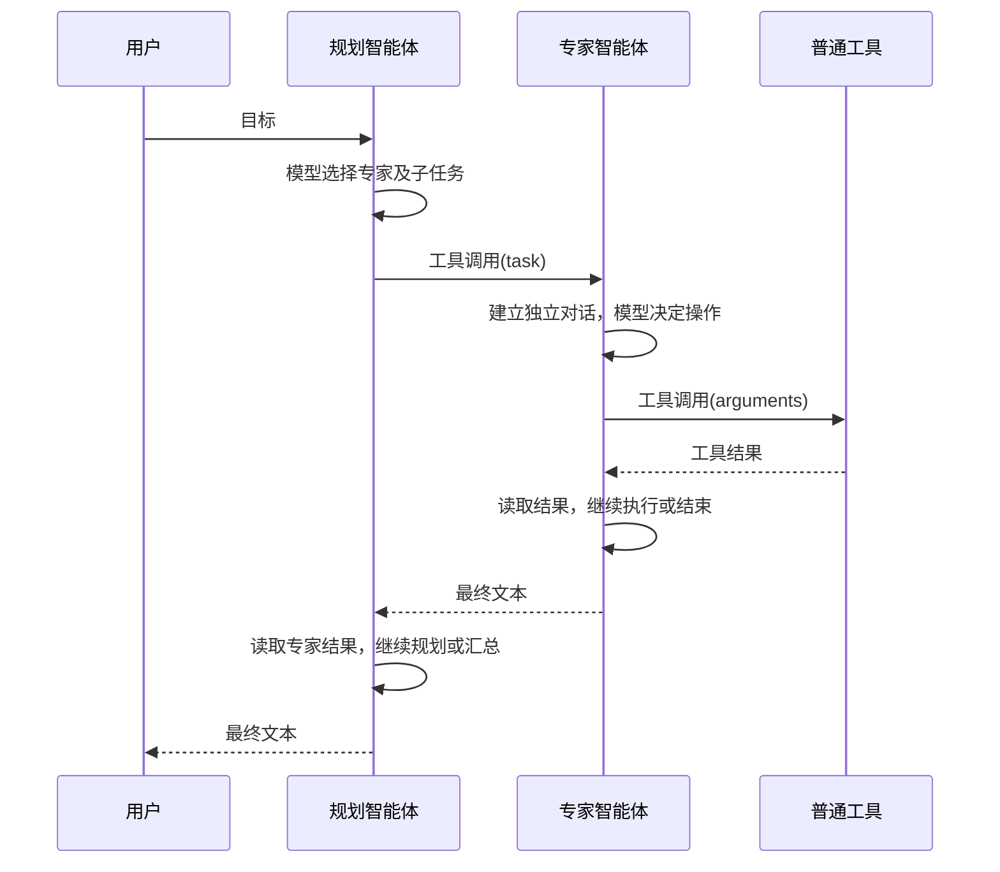

# 规划智能体 + 专家智能体

这个版本只保留原项目可复用的协作机制。具体领域策略、模型提供方和工具实现留给你决定。

## 原项目值得参考的逻辑

原项目把专家包装成函数工具交给上层模型选择。每个专家内部也使用同一个执行器运行自己的模型与工具循环。

| 原代码中的结构 | 精简后的对应结构 | 作用 |
| --- | --- | --- |
| `agent_util.PenetrationTesterAgent` | `runtime.Agent` | 调用模型、执行工具、反馈结果、继续决策 |
| CLI 中聚合专家的主智能体 | `planner.build_planner` | 将专家能力注册给规划模型 |
| 各个专家类 | `expert.build_expert` | 装配专家自己的提示词、模型和工具 |
| 专家的 `tools` / `tool_functions` | `Agent.as_tool` / `Tool` | 同时绑定工具说明、参数结构和执行函数 |
| 漏洞 / Linux 中间调度器 | 将另一个规划者 `as_tool` | 按需要增加中间层，机制相同 |

与原项目一致，规划者也可以直接使用普通工具；专家不是唯一可选的调用对象。各层同步执行，同一轮的多个工具依次执行。

## 运行

Python 3.10+，零第三方运行依赖。在本目录执行：

```powershell
python -m pentestllmagent
python -m unittest discover -s tests -v
```

示例输出一条完整调用链和 4 次模拟模型调用：规划者发起调用、专家发起工具调用、专家读取工具结果、规划者读取专家结果。`DemoModel` 是固定响应脚本，只验证连线；它不具备规划、理解任务或选择专家的能力。

## 执行过程



`Agent.run()` 每次创建新的消息列表。父层只把子任务和必要上下文传给子层，子层只返回最终文本；父层不会自动获得专家内部对话。要让下一位专家使用已有结果，由规划者把它们写入下一次 `task`。

## 以后在哪里填自己的设计

1. **规划者怎么干**：修改 `planner.py` 的 `PLANNER_PROMPT`，写入拆分任务、选人、失败后调整和结束条件。`descriptions` 是模型看到的专家能力说明，决定它能否正确选人。
2. **专家怎么干**：通过 `expert.py` 的 `build_expert()` 传入职责提示词 `instructions` 和工具列表 `tools`。不同专家可以使用不同的模型适配器。
3. **工具具体干什么**：参考 `demo.py`，构造 `Tool(name, description, parameters, handler)`。`parameters` 是提供给模型的 JSON Schema；`handler(arguments, context)` 执行实际业务，返回文本结果。执行器检查参数是否为对象，具体字段校验由 handler 负责。
4. **接哪个模型**：实现 `runtime.Model.complete(messages, tools)`，把调用委托给你选定的模型客户端。返回单条 assistant 消息，格式见下方。
5. **怎么组装**：参考 `demo.py`，先建工具，再建专家，最后把专家注册给规划者，调用 `planner.run(目标)`。

模型适配器返回格式：

```python
# 要执行工具时，arguments 为 JSON 字符串或字典。
{
    "role": "assistant",
    "content": None,
    "tool_calls": [{
        "id": "call_1",
        "type": "function",
        "function": {
            "name": "example_expert",
            "arguments": '{"task": "子任务及所需上下文"}',
        },
    }],
}

# 不再调用工具时，执行器把 content 作为该智能体的最终结果。
{"role": "assistant", "content": "最终结果"}
```

执行器把每次工具结果附加为 `role="tool"` 消息，并保留原 `tool_call_id`，下一轮交给当前模型。没有额外的强制总结请求；需要总结时由该层提示词指定。

如需增加调度层，可以这样组装，最外层不需要知道内层专家的工具细节：

```python
from pentestllmagent import build_planner

# sub_model、main_model 和两个专家实例由你自己的组装代码提供。
sub_planner = build_planner(sub_model, [expert_a, expert_b], ["A 的职责", "B 的职责"], name="group")
planner = build_planner(main_model, [sub_planner], ["这组专家的整体职责"])
result = planner.run("用户目标")
```

## 运行边界

- 每个智能体默认最多 10 轮模型调用，可通过 `Agent(max_rounds=...)` 配置；超限抛出 `RoundLimitExceeded`。专家超限会作为工具错误反馈给父层。
- 一次顶层任务默认共享 50 次模型调用额度，可传入 `RunContext(remaining_calls=...)` 修改。额度耗尽抛出 `BudgetExceeded`，终止整个调用树。
- 未注册工具、错误参数和工具异常会反馈为 `{"status": "error", ...}`，让模型决定下一步。顶层模型请求失败直接抛出异常。
- 示例不包含持久化记忆、缓存、自动重试、并行调度或网络超时控制。真实模型和工具适配器应自行配置超时。

原 MIT 许可证见 [LICENSE](LICENSE)。
